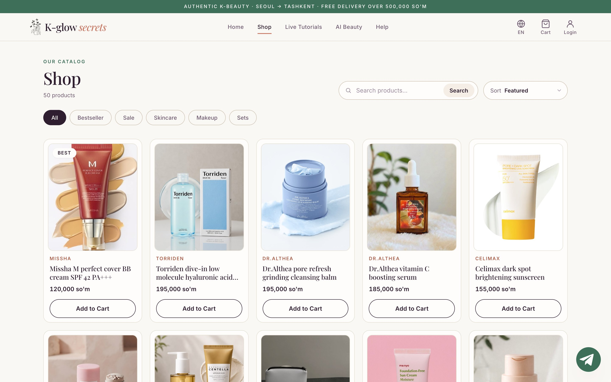
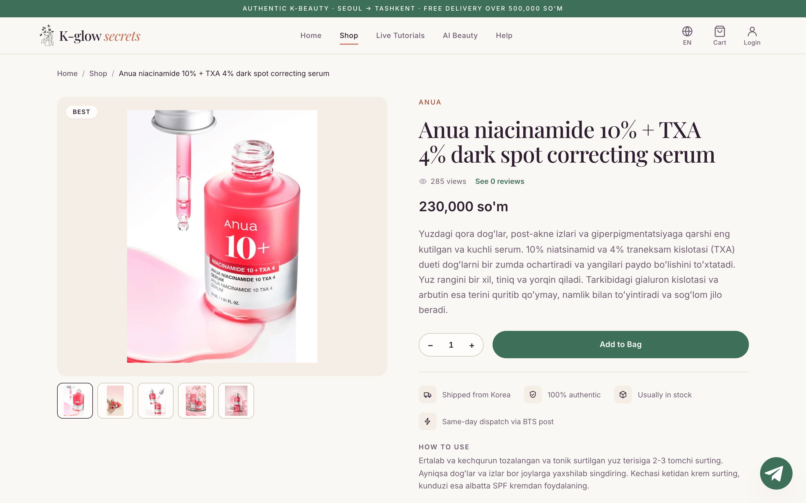
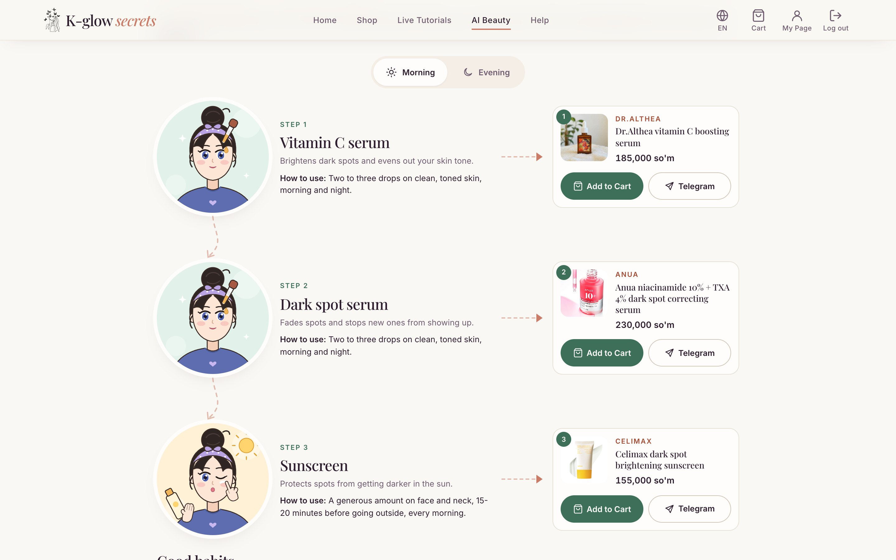
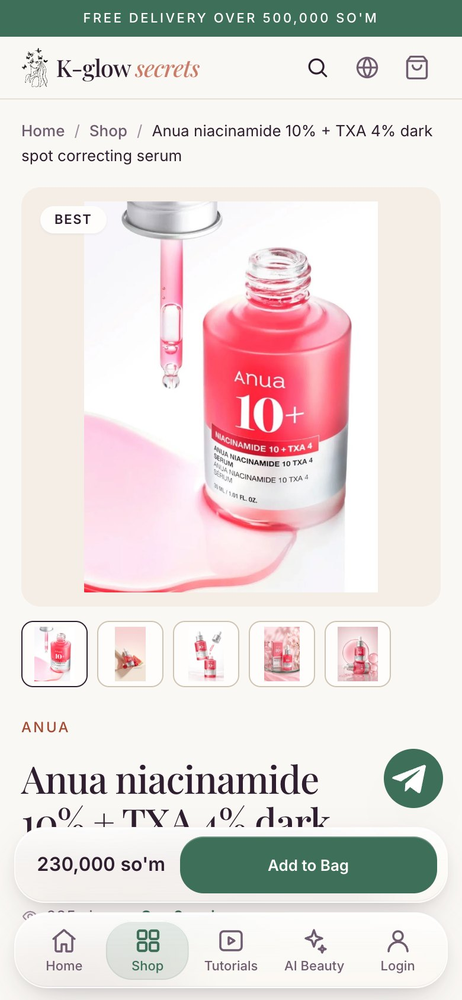
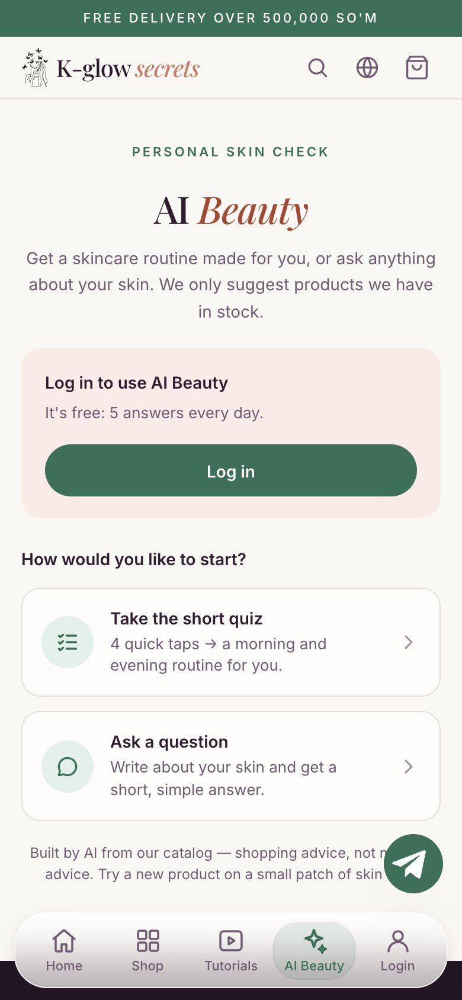
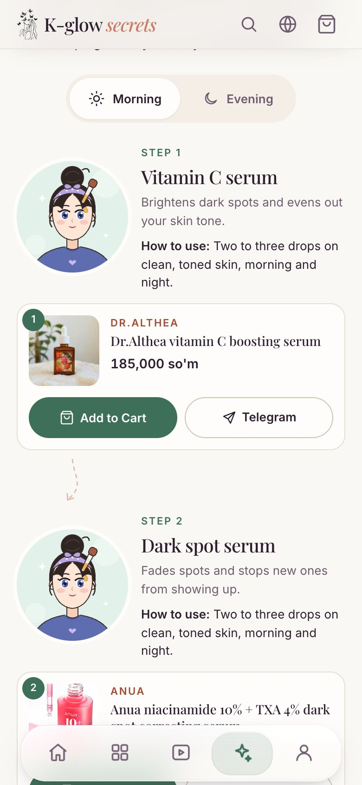

# K-Glow Secrets — Shop

**The customer-facing website of a live e-commerce business.** K-Glow Secrets sells original Korean skincare and makeup online and delivers across Uzbekistan. This repository is the shop that customers use: browsing, ordering, their account, and an AI skincare advisor — in three languages and designed for the phone first.

**Live shop:** [www.kglowshop.uz](https://www.kglowshop.uz) · **Backend:** [kglow-backend](https://github.com/sanjardevx/kglow-backend)

---

## At a glance

| | |
|---|---|
| **What it is** | The storefront of a real, running online shop — not a demo |
| **Who uses it** | Customers across Uzbekistan, mostly on their phones |
| **My role** | Sole developer and designer — UI/UX, frontend, backend, AI integration and deployment |
| **Built with** | React, TypeScript, Redux Toolkit, Vite, Vercel |
| **Languages** | Uzbek, Russian, English |

## Screenshots

**Home, shop and product page**


<p>
  
  
</p>

**AI Beauty — a personal routine as an illustrated step-by-step guide**



**On the phone**

<p>
  
  
  
  
</p>

## What customers can do

- **Shop** — browse, search, filter and sort the catalog; product pages with photo galleries, reviews and popularity.
- **Order** — a shopping bag and checkout with bank-transfer receipts, or order in one tap through Telegram.
- **Have an account** — sign up or **Sign in with Google**; see order history and a saved skin routine.
- **Get skincare advice** — **AI Beauty**: a four-tap skin quiz that builds a morning and evening routine from products in stock, shown as an illustrated guide, or a chat for direct questions.
- **Learn** — short video tutorials.
- **Use their language** — switch between Uzbek, Russian and English anywhere.

## Engineering highlights

- **Phone-first, app-like experience.** Bottom tab bar, frosted-glass header, sticky buy bars and large touch targets — built for one-handed use on a phone, then scaled up to desktop.
- **A real design system.** All colours, type and spacing come from one set of design tokens, so every page stays consistent and the look can change in one place. Accessible by default: keyboard focus, reduced-motion support and readable contrast.
- **Type-safe translations.** Every text lives in a dictionary per language, and TypeScript refuses to build if a language is missing a phrase.
- **Original illustrated AI guide.** The routine is drawn with hand-built SVG illustrations — a step for each kind of product — and revealed step by step.
- **Found by search engines and messengers.** A live sitemap and a search-engine-readable home page, plus rich link previews (photo, name and price) when a product is shared on Telegram or Instagram.
- **Quality gates.** Lint and a full type-checked production build run on every push; the site deploys automatically when they pass.

## Tech stack

| Area | Technology |
|---|---|
| UI | React 19, TypeScript, Material UI |
| State | Redux Toolkit, React Context |
| Routing | React Router |
| Styling | CSS with design tokens, mobile-first |
| Build & tooling | Vite, Oxlint |
| Hosting | Vercel (static site + serverless functions), Vercel Analytics |
| CI | GitHub Actions |

## Architecture

```
  Customer's browser
          │
          ▼
  Shop (this repo, Vercel)  ──►  Backend API  ──►  MongoDB · Claude AI · Google Sign-In
          │
          └── serverless functions: link previews, sitemap
```

Each page asks a small **service** for its data, keeps it in its own **Redux slice**, and renders from there; the login token is attached to every request in one place, so pages never handle it.

## Project structure

```
src/
  app/
    screens/       one folder per page (home, shop, cart, orders, account, AI Beauty, …)
    components/    header, footer, tab bar, modals, icons
    services/      talk to the backend API
    context/       the signed-in customer
  lib/i18n/        translations: Uzbek, Russian, English
  css/             design tokens, shared components, one stylesheet per page
api/               serverless functions (link previews, sitemap)
docs/              design system and screenshots
```

## Running locally

Requires Node.js 22+ and Yarn, plus a running backend.

```bash
yarn install
cp .env.example .env     # then fill in your own values
yarn dev
```

```bash
yarn build               # type-check and production build
yarn lint
```

## License

Source available for review only — **all rights reserved**. See [LICENSE](LICENSE).

## Author

**Sanjar Kurbonaliyev** — full-stack developer
[sanjardevx@gmail.com](mailto:sanjardevx@gmail.com) · [GitHub](https://github.com/sanjardevx)
